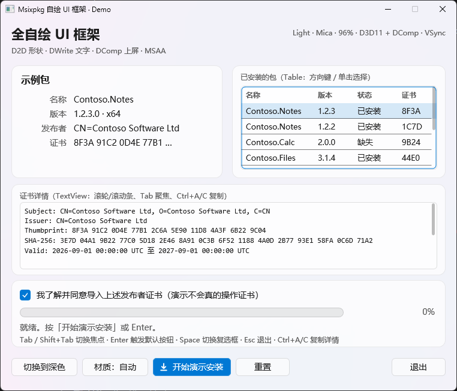
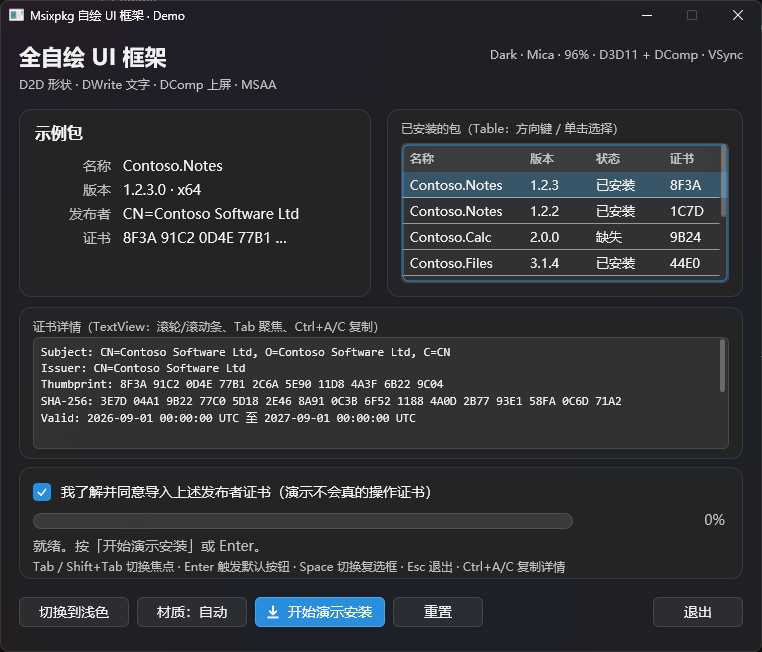
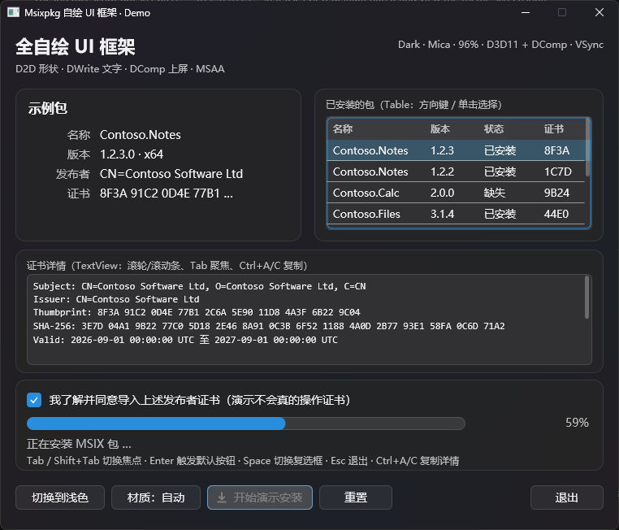
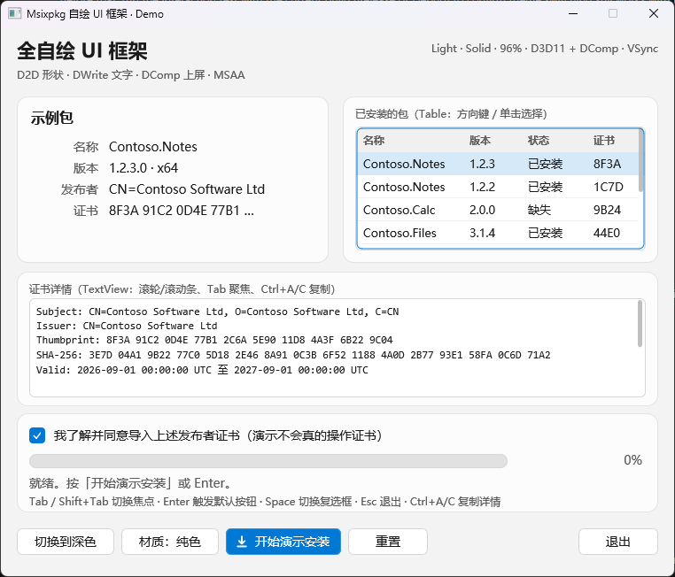
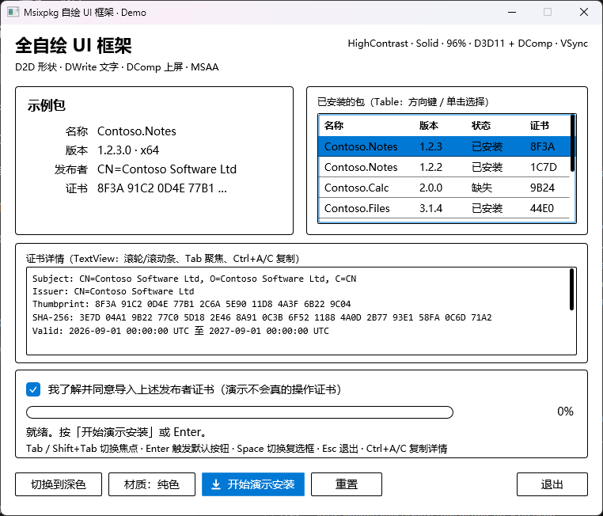

# Wren

> 小型、单 HWND、retained-mode 的 Windows 自绘 UI 框架。C++20，零第三方依赖。
> 状态：v0.1（2026-10-29，Windows 11 26H2 / 96 DPI 真机验证）。

Wren 把「一个窗口里所有东西都是自己画的」这件事收敛成一套可复用的模型：

- **默认 GPU 路径**：形状与文字由 Direct2D 画进一张纹理，`CopyResource` 到
  D3D11 + DirectComposition 的预乘 alpha 交换链，`Present` + `Commit` 上屏。
  Mica/Acrylic 从透明像素透出来，没有 `BitBlt` 撕裂。
- **回退路径**：D2D 或交换链不可用时退回 GDI+ 整帧 DIB（`SourceCopy`），窗口
  不会黑；再不行还有 `UpdateLayeredWindow` 的 layered 模式。
- **同一套控件 / 布局 / 焦点 / MSAA 模型**跑在两条路径上，控件代码不写 `#ifdef`。

它不是通用 UI 库：没有布局引擎、数据绑定、文本输入、动画系统和多窗口。目标场景
是安装器、更新器、配置向导这类**固定尺寸、控件类型有限、对材质与无障碍有要求**的
桌面小工具。



|  |  |
|---|---|
|  |  |
|  |  |

## 特性

| 方面 | 提供什么 |
|---|---|
| 窗口 | 单 HWND，无子窗口；固定 DIP 尺寸，PerMonitorV2 + `WM_DPICHANGED` |
| 绘制 | `Canvas` 一套绘制动词，两个后端：`ID2D1DeviceContext`（硬件）/ GDI+ DIB（软件） |
| 呈现 | `Presenter`：GPU 组合交换链（默认）/ GDI 重定向位图 / layered window |
| 材质 | Mica（属性 38+39）/ Acrylic（动态加载未文档化 API）/ Solid，逐级降级，HC 下自动 Solid |
| 文字 | DirectWrite 灰度 AA，唯一的测量与绘制来源（`IDWriteTextLayout` 同源） |
| 控件 | Label / Button / Checkbox / ProgressBar / TextView / Table（含自绘滚动条） |
| 交互 | Tab 焦点链、Enter 默认按钮、Esc、Space、方向键、Home/End/PageUp/PageDown、Ctrl+A/C、滚轮、鼠标捕获 |
| 无障碍 | MSAA `IAccessible` 根 + 可见控件 + Table 行；角色/状态/名字/值/焦点/选择/命中测试/导航 + 四类事件 |
| 节拍 | 合成器时钟驱动；默认每 tick 一帧（跟随刷新率），`set_animating(false)` 后空闲 0% CPU |
| 诊断 | `FrameStats`：分项耗时、间隔中位数/p95、丢帧、反推刷新率 |

## 快速开始

```powershell
cmake -S . -B build -G "Visual Studio 18 2026" -A x64
cmake --build build --config Debug

build\Debug\wren-demo.exe                       # 跟随系统主题/材质
build\Debug\wren-demo.exe --theme dark --material mica
build\Debug\wren-demo.exe --theme light --material solid
build\Debug\wren-demo.exe --presenter gdi       # 强制软件路径
build\Debug\wren-demo.exe --fps 60              # 默认跟随刷新率，这里限到 60
```

demo 参数：

| 参数 | 说明 |
|---|---|
| `--theme light\|dark\|hc` | 强制外观；缺省 `auto`（跟随系统） |
| `--material auto\|solid\|mica\|acrylic` | 强制材质；`auto` 依次尝试 Mica → Acrylic → Solid |
| `--presenter gpu\|gdi\|layered` | 强制呈现后端；`gpu` 失败自动退 `gdi`（等价于环境变量 `WREN_PRESENTER`） |
| `--fps <hz>` | 动画帧率；`0`（默认）= 每个合成器 tick 一帧，即跟随刷新率 |
| `--report <path>` | 把主题/材质/DPI、MSAA 子对象清单与帧统计写到文件 |
| `--auto` | 约 0.7s 后自动开始演示安装（截图/基准用） |
| `--exit-after <ms>` | 到时间关窗，退出前再写一次 `--report` |

单测（不需要窗口，纯逻辑）：

```powershell
build\Debug\wren-tests.exe
# 或 ctest --test-dir build -C Debug --output-on-failure
```

## 接入宿主工程

作为 submodule 放在任意目录，`add_subdirectory` 之后链 `Wren::wren` 即可：

```cmake
add_subdirectory(third_party/wren)
target_link_libraries(my_app PRIVATE Wren::wren)
```

`wren` 是 `STATIC` 库，`PUBLIC` 带上了 include 目录、`UNICODE/_UNICODE`、
`WIN32_LEAN_AND_MEAN`、`NOMINMAX` 和全部系统库（`d2d1 dwrite d3d11 dcomp dxgi
dwmapi gdiplus oleacc oleaut32 ole32 user32 gdi32 advapi32`），宿主不需要再配。
`WREN_BUILD_DEMO` / `WREN_BUILD_TESTS` 在作为子工程时默认关闭。

最小程序：

```cpp
#include "host.h"
#include "controls.h"

#include <Windows.h>

int wmain() {
    auto root = std::make_unique<wren::Panel>();

    auto* title = root->emplace<wren::Label>(L"Hello Wren", wren::TextStyle{.size = 22.0f, .weight = 600});
    title->bounds = {24.0f, 24.0f, 320.0f, 32.0f};

    auto* button = root->emplace<wren::Button>(L"点我", [] { ::MessageBoxW(nullptr, L"Hi", L"Wren", MB_OK); });
    button->bounds = {24.0f, 72.0f, 120.0f, 32.0f};
    button->set_primary(true);
    button->set_default(true);   // Enter 触发

    wren::HostOptions options;
    options.title = L"Hello Wren";
    options.width_dip = 420;
    options.height_dip = 160;

    wren::Host host;
    if (!host.create(::GetModuleHandleW(nullptr), std::move(root), options)) {
        return 1;
    }

    return host.run();
}
```

布局就是给每个 Widget 一个 DIP 矩形（`bounds`），由调用方自己算——没有
measure/arrange 约束系统。`WM_DPICHANGED` 只改 DPI 与帧尺寸，DIP 布局值不变。

## 架构

```
            Widget 树（retained）：Panel / Label / Button / Checkbox
                       ProgressBar / TextView / Table
                          │ bounds(DIP)   paint(Canvas&)
                          ▼
   Host（单 HWND）：消息泵 · 焦点链 · 键盘 · 鼠标 · DPI · 帧统计 · WM_GETOBJECT
                          │
              Canvas（一套绘制动词，两个后端）
              ├─ ID2D1DeviceContext ─┐
              └─ GDI+ Bitmap (DIB)  ─┼─→ Presenter（GPU / GDI / Layered）
              DirectWriteText ───────┤   （灰度 AA，两条后端共用一份 layout）
              Material ──────────────┘   （Mica / Acrylic / Solid）
```

| 文件 | 职责 |
|---|---|
| `canvas.*` | 双后端绘制动词、`Frame` DIB、字体/格式缓存、测量、裁剪 |
| `dwrite_text.*` | DirectWrite 灰度 AA 文字后端（唯一绘制 + 度量来源） |
| `text_layout.*` | 换行算法（CJK 逐字、拉丁按词、超长词硬拆、`\n`/`\r\n`） |
| `theme.*` | Light/Dark/HC 令牌、系统强调色 |
| `widget.*` | `Widget` / `Panel` / 命中测试 / 焦点态 / 无障碍默认值 |
| `controls.*` | 七个控件 + 共用滚动条几何 |
| `host.*` | 单 HWND、合成器节拍、焦点链、键盘、DPI、帧统计、`WM_GETOBJECT` |
| `material.*` | Mica / Acrylic / Solid，逐级降级 |
| `presenter.*` / `gpu_presenter.*` | 呈现接口；GDI / layered 实现；D3D11 + DComp 实现 |
| `automation.*` | `IAccessible` 根/子对象 |
| `demo/wren_demo.cpp` | 760×620 演示，覆盖全部控件与主题/材质切换 |

### 渲染管线

D2D 不能直接拿组合交换链的 back buffer 当 target（`CreateBitmapFromDxgiSurface`
返回 `E_INVALIDARG`），所以每帧：D2D `BeginDraw` → 形状 + 文字 → `EndDraw` →
`CopyResource` 到 back buffer → `Present(1)` → `IDCompositionDevice::Commit`。
窗口自己的重定向位图必须清成 alpha=0（`PatBlt(BLACKNESS)`），否则 Mica 会被不透明
底色盖住。

组合交换链的 `Present` **不做反压**（不管它就是 900+ fps 空转），所以 `Host::run`
用 `DCompositionWaitForCompositorClock` 等 DWM 的合成时钟：

- `set_animating(true, 0)` → 每个 tick 一帧，180Hz 屏跑 180fps（默认）
- `set_animating(true, 16)` → 按实测周期折算成「每 N 个 tick 一帧」
- `set_animating(false)` → 主循环回到纯消息等待，空闲 0–1% CPU

文字统一走 DirectWrite 灰度 AA：透明/半透明表面上 ClearType 必然出彩边，除非再开
一套「不透明才 ClearType」的后端——那会让标题与正文来自两份排版、基线和字形错位。
单一后端让测量与绘制共用同一份 `IDWriteTextLayout`。

## API 速查

```cpp
wren::Host          create() / run() / quit() / close()
                    invalidate() / layout_changed() / set_tick_handler()
                    set_appearance() / set_material() / set_animating(bool, int interval_ms = 33)
                    schedule_once(delay_ms, callback) / focus_widget() / focus_next()
                    frame_stats() / reset_frame_stats() / accessibility_request_count()

wren::Widget        paint(Canvas&) / hit_test(x, y) / on_mouse(MouseEvent) / on_key(KeyEvent)
                    tick(dt_seconds) / on_focus() / on_blur() / on_theme_changed()
                    accessible_name / role / state / value / default_action + accessible_row_count()

wren::Canvas        fill_rect / fill_round_rect / stroke_round_rect / draw_line
                    draw_text / draw_icon / draw_image / push_clip / pop_clip

wren::Theme         make_theme(Appearance, bool high_contrast) → token（表面、文字、强调色）
wren::Material      Mica / Acrylic / Solid 的探测与降级由 Host 自动完成
```

自定义控件：继承 `Widget`，实现 `paint`（可选 `hit_test` / `on_mouse` / `on_key` /
`accessible_*`），用 `Theme` 取色、用 `Canvas` 绘制即可。demo 里 `Card` 就是一个
十行的自定义 Widget——框架不提供 Card，是因为这类装饰性容器应该由使用方按自己的
视觉语言实现。

## 性能

Release，760×620，浅色 Mica，安装进度动画（本机 RTX 4060 Ti / 180Hz / 28 线程）：

| 路径 | 平均间隔 | p95 | 丢帧 | render | present | CPU（单核） |
|---|---|---|---|---|---|---|
| D2D + DComp，跟随刷新率（默认） | 5.56 ms（180 fps） | 5.65 ms | 0 / 696 | 0.72 ms | 0.46 ms | 31–38% |
| D2D + DComp，`--fps 60` | 16.67 ms（60 fps） | 16.89 ms | 0 | 0.78 ms | 0.52 ms | 10–21% |
| GDI+ DIB + SourceCopy | 25–38 ms（27–40 fps） | 32–107 ms | 58–72 | 16–27 ms | 4.8–8.4 ms | 67–77% |

空闲（无动画）两条路径都是 0–1%。数值随系统负载浮动；`paint` 从 ~14 ms 降到
<0.1 ms 是 D2D 硬件路径的主要收益。

## 平台与已知限制

- Windows 10 1809+ 可跑 GDI+ 路径；Mica 需要 Win11，Acrylic 在 Win10 22H2 未验证。
- 硬件路径依赖 D3D11 + DirectComposition；失败自动退 GDI+，但软件路径只有 27–40 fps。
- 全框架灰度 AA，不追求 ClearType（理由见上）。
- 多显示器 / VRR 未验证：节拍跟随窗口所在合成器的时钟。
- DPI 代码路径完整，但只在 96 DPI 真机验证过。
- `draw_image()` 在 D2D 路径是空实现（当前控件集不用图片）；GDI 回退仍支持。
- TextView 只读（Ctrl+A/C），无鼠标拖选、无 IME 输入。
- Table 列宽固定，无排序、无列宽拖动、无双击。
- layered 模式没有系统 caption/shadow，顶部区域用于拖动，是备选路径。

## 设计文档

[`docs/design.md`](docs/design.md) 是这个框架的设计依据（最初为 msixpkg 安装器编写，
文中出现的「安装器」「42 个 ControlSpec」「五页」等是宿主侧上下文；命名空间
`msixpkg::ui` 已改为 `wren`，代码路径即本仓库根目录）。

## 许可

本项目暂无 LICENSE 文件；在补上之前按「保留所有权利」理解。
